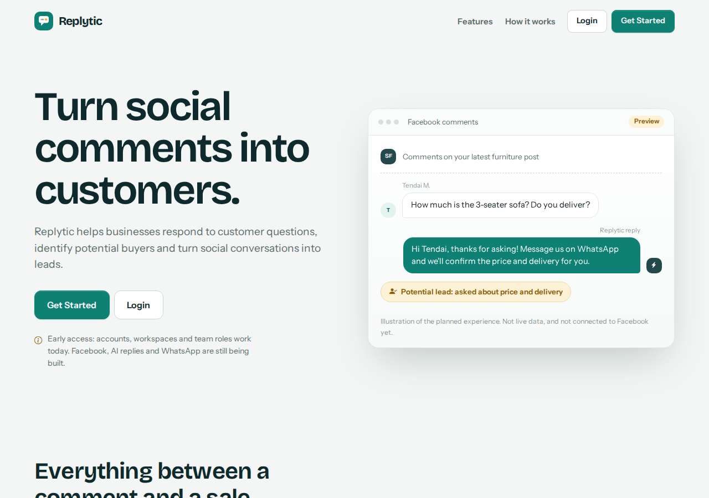
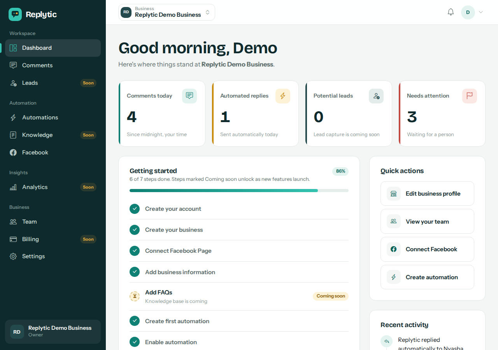

# Replytic

> **Turn social comments into customers.**

Replytic is a multi-tenant SaaS platform for businesses that want to manage customer comments and enquiries from social media. The long-term product monitors Facebook Page comments, identifies customer intent, answers common questions, captures leads, routes serious enquiries to WhatsApp, lets humans take over, and reports analytics.

**Status: Phases 1 (SaaS foundation), 2 (Facebook connection) and 3 (comment engine) are complete.** There is no AI, WhatsApp, payment, Celery or Redis code yet. Replies come from keyword rules you write (no AI understanding until Phase 4). The app runs locally on SQLite; Facebook features need a Meta app (see below) but everything else works without credentials.

## Screenshots

All screens below use the built-in demo account (`python manage.py seed_demo`); no real business data is shown.

| | |
|---|---|
|  **Landing page** |  **Dashboard** — real metrics, onboarding checklist, recent activity |
|  **Comments inbox** — suggested replies waiting for approval, one sent automatically |  **Automations** — per-Page reply mode and keyword rules |
|  **Facebook** — connected account and watched Pages |  **Mobile** — collapsible sidebar |

## Features (Phase 1)

- Registration, login, logout, password change and password reset (reset emails print to the console)
- Registering creates the user, their business (organization) and an **OWNER** membership, then signs them in
- Multi-business architecture: one user can belong to many organizations and switch between them
- Roles: **OWNER**, **ADMIN**, **AGENT**, backed by a central permission map
- Server-side tenant isolation (see below)
- Dashboard with honest zero-state metrics, onboarding checklist, quick actions and real recent activity
- Team page (list members, change role, remove member; invitations are a placeholder)
- Settings: business profile (with logo upload), account, security, team, integrations, billing
- Polished placeholder pages: Comments, Leads, Automations, Knowledge, Facebook, Analytics, Billing
- Branded 400/403/404/500 pages; Django admin for User, Organization and OrganizationMembership
- Responsive UI (collapsible sidebar on mobile); Bootstrap 5 customised into the Replytic design system
- **Phase 2:** connect Facebook via OAuth, choose which Pages to watch, subscribe Pages to `feed` webhooks, receive and store signed webhook events per business, disconnect at any time
- **Phase 3:** comments inbox, keyword automation rules, safe public replies, duplicate prevention
- 218 automated tests, including tenant isolation for Facebook, comments and rules

## Technology

Python, Django 5, SQLite, Django templates, HTML5/CSS3, Bootstrap 5 and vanilla JavaScript. Bootstrap, Bootstrap Icons and the two fonts (Bricolage Grotesque, Instrument Sans) are **vendored in `static/`**, so the UI works offline. Python dependencies: Django, Pillow (logo uploads) and cryptography (encrypting Facebook tokens). The Graph API is called with the standard library.

## Project structure

```
replytic/
├── manage.py
├── config/            settings, root urls, wsgi/asgi
├── accounts/          auth forms, services, views, email-or-username backend
├── organizations/     Organization + Membership models, roles/permissions,
│                      current-organization middleware, team & settings views,
│                      seed_demo command
├── dashboard/         dashboard + placeholder module pages, dashboard services
├── facebook/          Meta OAuth, Pages, webhook receiver, encrypted tokens, Graph client
├── comments/          Comment + Reply models, ingestion, sending, inbox, process_comments command
├── automations/       AutomationRule model, rule engine (pure functions), rule & Page-mode UI
├── core/              landing page, shared mixins, navigation, context
│                      processor, form mixin, error handlers
├── templates/         base/, accounts/, dashboard/, organizations/, core/,
│                      components/ (reusable partials), errors/
├── static/            css/replytic.css (design system), js/app.js, vendor/, fonts/
├── media/             uploaded logos (git-ignored)
├── tests/             automated tests
├── requirements.txt
├── .env.example
└── README.md
```

## Installation

```bash
python -m venv venv

# Linux / macOS
source venv/bin/activate
# Windows
venv\Scripts\activate

pip install -r requirements.txt
python manage.py migrate
python manage.py createsuperuser   # optional, for /admin/
python manage.py runserver
```

Open http://127.0.0.1:8000/.

### Demo data (optional)

```bash
python manage.py seed_demo
```

Creates (or refreshes) `demo@replytic.local` / `DemoPassword123!`, the OWNER of **Replytic Demo Business**. It never runs automatically, and running it again is safe.

### Tests

```bash
python manage.py test
```

### Environment variables

Copy `.env.example` to `.env` (optional for local development):

| Variable | Purpose | Default |
|---|---|---|
| `SECRET_KEY` | Django secret key. Required when `DEBUG=False`. If empty in debug mode a throw-away key is generated (sessions reset on restart). | none |
| `DEBUG` | `True` / `False` | `True` |
| `ALLOWED_HOSTS` | Comma-separated hosts | `127.0.0.1,localhost` |
| `SITE_URL` | Public base URL; used to build the OAuth redirect and webhook URLs | `http://localhost:8000` |
| `META_APP_ID`, `META_APP_SECRET` | From your Meta app | none |
| `META_WEBHOOK_VERIFY_TOKEN` | Any long random string you also enter in Meta's webhook settings | none |
| `META_GRAPH_VERSION` | Graph API version. Check the current one in your Meta app dashboard | `v23.0` |
| `META_LOGIN_CONFIG_ID` | Only for apps using Facebook Login for Business | none |
| `META_SCOPES` | Permissions requested (classic Facebook Login) | `pages_show_list,pages_manage_metadata,pages_read_engagement,pages_read_user_content,pages_manage_engagement` |
| `TOKEN_ENCRYPTION_KEY` | Fernet key that encrypts stored Facebook tokens. **Required when `DEBUG=False`.** | derived from `SECRET_KEY` in debug |

## No domain yet? Use a free tunnel

Facebook needs a public **HTTPS** address, but you don't need to buy a domain to develop. Use a tunnel that forwards a public URL to your laptop:

1. **ngrok** (recommended): create a free account, install ngrok, run `ngrok config add-authtoken <token>`, then claim your free static domain in the ngrok dashboard (Domains). Start it with the command the dashboard shows, e.g. `ngrok http 8000 --url=your-name.ngrok-free.app`. Because the domain is static, you only configure Meta once.
2. **Cloudflare quick tunnel** (no account): `cloudflared tunnel --url http://localhost:8000`. The address changes every run, so you would need to update Meta each time.

Then set `SITE_URL=https://your-name.ngrok-free.app` in `.env` and restart. Replytic automatically trusts that host and origin. Open Replytic through that address too (so cookies and redirects match). ngrok's free plan may show a one-time "Visit site" warning page in your browser.

With that domain, these are the values to paste into the Meta app dashboard (they are also shown to staff on Replytic's Facebook page under *Setup details*):

| Meta field | Value |
|---|---|
| Valid OAuth redirect URI | `https://your-name.ngrok-free.app/facebook/callback/` |
| Deauthorize callback URL | `https://your-name.ngrok-free.app/facebook/deauthorize/` |
| Data deletion request URL | `https://your-name.ngrok-free.app/facebook/data-deletion/` |
| Webhook callback URL (Page object) | `https://your-name.ngrok-free.app/webhooks/facebook/` |

**Deauthorize** (someone removes Replytic in Facebook settings) and **data deletion** (someone asks Facebook to delete their data) are both verified with Meta's `signed_request` signature. They delete that Facebook user's connections and encrypted tokens across all businesses (Page rows are kept, with their token erased, so a business's comment history is never lost; comments written *by* that Facebook user are erased), and the deletion callback returns a public status page with a confirmation code. Only a hash of the Facebook user id is kept.

## Connecting Facebook (Phase 2)

1. Create an app at https://developers.facebook.com and add **Facebook Login** (or **Facebook Login for Business**) and **Webhooks**. Put `META_APP_ID` and `META_APP_SECRET` in `.env`.
2. Set `META_WEBHOOK_VERIFY_TOKEN` to a long random string.
3. In the app's Facebook Login settings add the redirect URI shown under *Setup details* on Replytic's Facebook page (`SITE_URL/facebook/callback/`). For local testing use `http://localhost:8000` and browse via `localhost`, not `127.0.0.1`.
4. Webhooks require a public **HTTPS** URL. For local testing run a tunnel (ngrok, Cloudflare Tunnel), set `SITE_URL` to its https address, add it to `ALLOWED_HOSTS`, and restart.
5. In Meta's Webhooks settings choose the **Page** object, set the callback to `SITE_URL/webhooks/facebook/` with your verify token, and subscribe to the **feed** field.
6. In Replytic open **Facebook**, click *Connect Facebook*, approve permissions, then click *Watch this Page* on each Page.

While the app is in Meta's Development mode, only people with a role on the app can connect. Public use requires Meta App Review and Business Verification (Phase 10).

**Security design:** OAuth `state` is random, single-use, time-limited and bound to the user and business; access tokens are encrypted at rest and never rendered; webhook bodies are trusted only after HMAC-SHA256 verification with the app secret (constant-time compare); the webhook fails closed if secrets are missing; a Page can be *watched* by only one business at a time (enforced by a database constraint); and every Facebook record is queried through `request.organization`.

## The comment engine (Phase 3)

```
Facebook ─► webhook ─► FacebookWebhookEvent ─► process_comments ─► Comment ─► rules ─► Reply (draft or sent)
```

Run the worker in a second terminal (there is no Celery yet; Phase 10 adds real background workers):

```bash
python manage.py process_comments --watch          # checks every 5 s
python manage.py process_comments                  # process once and exit
```

Team members can also press **Check for new comments** on the Comments page to process their own business's waiting updates.

**Rules** (Automations page) match keywords as whole words or phrases, case-insensitively, in any language. First match by priority wins. Actions: *Reply*, *Flag for a person*, *Ignore*. Replies can use `{first_name}`, `{page_name}`, `{business_name}`, `{phone}`, `{whatsapp}`. A **Test your rules** box shows what would happen without storing or posting anything.

**Each Page has a mode:**

| Mode | Behaviour |
|---|---|
| Off | Comments are collected only |
| **Suggest replies (default)** | A matching rule writes a draft; a person approves, edits or discards it |
| Reply automatically | Matching replies are posted publicly straight away. Needs explicit confirmation by an owner/admin |

**Safety rules enforced in code:**
- One live reply per comment, enforced by a database constraint plus an atomic claim before sending. Double clicks, retries and racing workers cannot post twice.
- Automatic replies fall back to a draft when a placeholder is empty in the business profile, the comment is older than 24 hours, the Page's hourly limit is reached, or automation was switched off meanwhile.
- The Page's own comments are never answered (no reply loops); edited comments never trigger a second reply.
- Comments are de-duplicated on Facebook's comment id, so webhook redeliveries are harmless.
- Missing reply permission, expired tokens and Facebook errors are recorded on the comment with a Retry button.
- Comment text is always HTML-escaped; every comment, reply, rule and Page lookup is scoped to `request.organization` (other tenants' ids return 404).

**Meta permissions:** reading comments needs `pages_read_user_content` and replying needs `pages_manage_engagement`. Both require App Review for public use; in Development mode they work for people with a role on your app. Accounts connected before Phase 3 must reconnect (the Facebook page prompts them).

## Troubleshooting Facebook

Two commands exist specifically to tell Replytic's side apart from Facebook's side, without guessing:

```bash
python manage.py facebook_diagnose
```
Checks your `.env`, every connection, every Page and how many webhook events have ever arrived — all locally, no network calls. Shows `OK` or `FAIL` with the reason for each. Run this first for any "comments aren't showing up" report.

```bash
python manage.py send_test_webhook --message "How much is this?"
python manage.py process_comments
```
Sends a correctly signed fake comment straight to your own webhook endpoint, exactly as Facebook would, then processes it. If it appears in **Comments**, Replytic's entire pipeline (receive → store → match a rule → draft/send a reply) works, and whatever is still wrong is on Facebook's side: check that `feed` is subscribed under **Webhooks → Page** in your Meta app, and that the person commenting has a role on the app (Development mode limits delivery to app roles until the app passes App Review). Note the test comment's reply will fail if you send it for real, since its comment id is fake — that's expected, just discard it.

A real incident this caught: `SECRET_KEY` left unset in `.env` meant a new throw-away key was generated on every restart in development. Since the fallback Facebook-token encryption key is derived from `SECRET_KEY`, every restart silently made previously stored tokens undecryptable — while the UI still showed the Page as "Connected". `SECRET_KEY` is now generated once and written back into `.env`, so it survives restarts; `facebook_diagnose` also detects and reports undecryptable tokens directly, with the fix (reconnect Facebook).

## SaaS architecture

```
User ──< OrganizationMembership >── Organization ──< organization-owned data (future)
              (role: OWNER | ADMIN | AGENT)
```

- An **Organization** is one business using Replytic. Primary keys are UUIDs, so they are not guessable.
- A **User** may belong to several organizations; an organization has many users.
- Business logic lives in `services.py` modules. Views receive the request, authorize, call a service and respond.
- Feature access is defined once in `organizations/permissions.py` and consumed by views (`required_permission`), templates (`can.manage_team`) and the sidebar.

| Area | Owner | Admin | Agent |
|---|:-:|:-:|:-:|
| Dashboard, comments, leads, team list | yes | yes | yes |
| Automations, knowledge, Facebook, analytics | yes | yes | no |
| Edit business profile | yes | yes | no |
| Remove agents | yes | yes | no |
| Change roles, remove anyone | yes | no | no |
| Billing | yes | view | no |

The last remaining owner can never be demoted or removed.

## Tenant isolation

Isolation is enforced on the server and never depends on hidden UI or URL ids:

1. `CurrentOrganizationMiddleware` runs on every request and sets `request.organization` and `request.membership`. The id in `session["current_organization_id"]` is only a **hint**: it is used only if the user is a member of that active organization; otherwise the user's first membership is used.
2. Switching organizations is POST-only and validates membership. Non-members are rejected and the session is left unchanged.
3. Every organization-scoped view takes the organization from `request.organization`, never from the request body or URL. Detail lookups use `get_object_or_404(Model, pk=..., organization=request.organization)`, so an id from another tenant returns **404**.
4. Forms are bound to the verified organization instance; posted `id` / `organization_id` values are ignored.

**Rule for future phases:** every new model that belongs to a business must have an `organization` foreign key and be queried through `request.organization`. `tests/test_tenant_isolation.py` shows the pattern to extend.

## Roadmap

| Phase | Scope |
|---|---|
| **1 (this)** | Auth, organizations, roles, tenant isolation, dashboard, settings, team, placeholders |
| **2 (done)** | Facebook integration: Meta app, OAuth, Page connection and selection, webhook |
| **3 (done)** | Comment engine: comments, public replies, duplicate prevention, rule engine |
| 4 | AI: intent detection, reply generation, business knowledge, confidence thresholds |
| 5 | Lead management: capture, pipeline, human takeover |
| 6 | WhatsApp: routing, messaging, sales workflow |
| 7 | Analytics: engagement, lead analytics, performance |
| 8 | Billing: subscriptions, usage, plans |
| 9 | Orbit POS integration: products, prices, inventory, customer sync |
| 10 | Production: HTTPS, production database, background workers, monitoring, Meta app review, deployment |

Future modules (`facebook/`, `ai/`, `leads/`, `billing/`) should each be their own Django app with a `services.py`, added alongside `dashboard`, with the matching placeholder page in `dashboard/` replaced by a real view.

## Before you push this

- **License.** No `LICENSE` file is included. Add one (MIT, Apache-2.0, or "All rights reserved" if the repo should stay closed) before making the repository public, since without one no one — including you, legally, in some jurisdictions — has clear reuse rights.
- **Secrets.** `.gitignore` already excludes `.env`, `.dev_secret_key`, `db.sqlite3` and `media/`. Double-check `git status` before your first commit; none of these should appear.
- **Rotate anything already exposed.** If a Meta App Secret, webhook verify token, or Facebook access token was ever pasted into a chat, ticket, or committed by mistake, treat it as compromised and regenerate it in the Meta dashboard.
- **Demo vs. real data.** The screenshots above come from `seed_demo`, not a real business. If you add your own, consider doing the same so no live business name, phone number or Page id ends up in the public repo's history.
